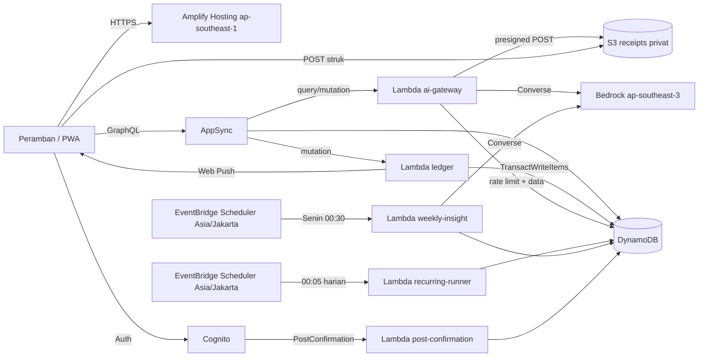
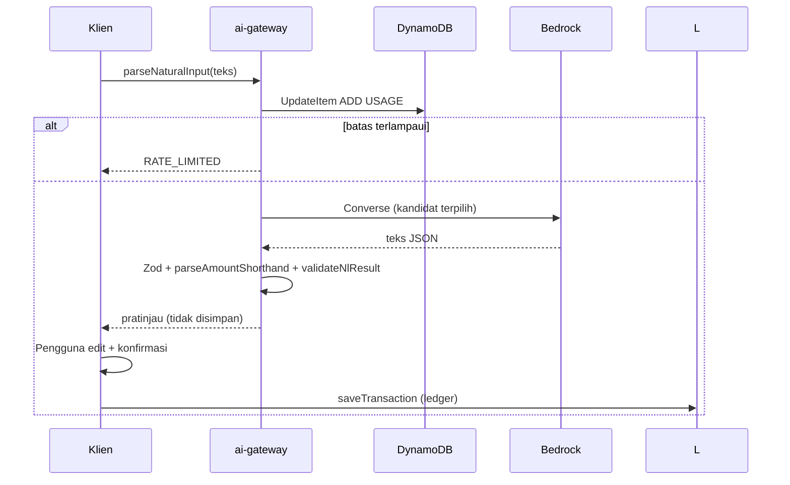
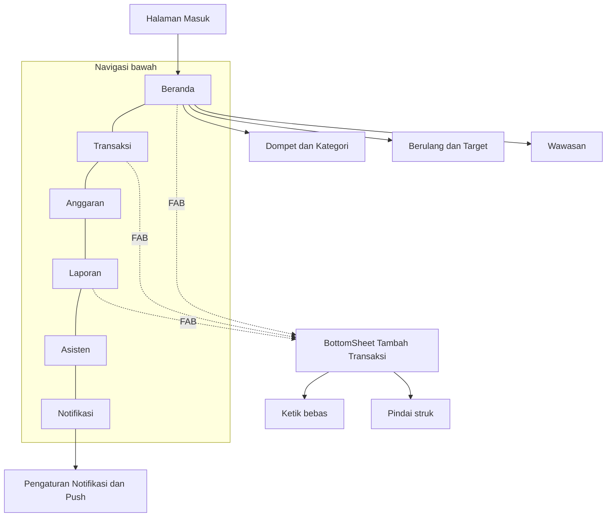

# Design Document: Arto Expense Tracker

## Overview

Arto adalah aplikasi web mobile-first (PWA) berbahasa Indonesia untuk mencatat pemasukan dan pengeluaran, merencanakan anggaran, serta memakai AI (Amazon Bedrock Nova Lite) sebagai asisten keuangan. Satu Pengguna per akun, data privat per pemilik, mata uang hanya Rupiah.

Tumpukan teknologi: TypeScript, React 18 + Vite, AWS Amplify Gen2 (Cognito, AppSync/DynamoDB, S3, Lambda), EventBridge Scheduler, dan Bedrock.

Prinsip desain:

- Logika keuangan berada di `shared/domain` sebagai fungsi murni, dipakai bersama oleh frontend dan Lambda. Fungsi murni inilah target uji properti.
- Semua perubahan yang memengaruhi saldo lewat Lambda `ledger` dengan DynamoDB `TransactWriteItems` (atomik). Klien hanya membaca model tersebut.
- Semua panggilan AI lewat Lambda `ai-gateway`. Nova Lite tidak punya structured output, sehingga hasil model selalu divalidasi dengan Zod dan fungsi domain sebelum dipakai.
- Region Bedrock dibaca dari `BEDROCK_REGION`, tidak tertanam di kode.
- Repositori: `https://github.com/josephmichaelp/arto.git`. Token, kata sandi, atau kredensial apa pun tidak boleh ada di berkas, URL remote, skrip, atau riwayat git. Autentikasi memakai `gh auth login` atau Git Credential Manager.

### Asumsi dan Keputusan

| ID | Asumsi atau keputusan | Status |
|----|-----------------------|--------|
| K-1 | Nominal adalah bilangan bulat Rupiah (`number` aman sampai 2^53-1). Tidak ada pecahan. | Ditetapkan |
| K-2 | Tanggal Transaksi disimpan sebagai string `YYYY-MM-DD` dan bulan `YYYY-MM` menurut WIB. Stempel waktu sistem disimpan ISO UTC. | Ditetapkan |
| K-3 | Setoran ke Target_Tabungan mengurangi saldo Dompet tetapi bukan pengeluaran: tidak masuk Laporan dan realisasi Anggaran. | Perlu konfirmasi pemilik |
| K-4 | Pengeluaran boleh membuat saldo Dompet negatif. Hanya transfer dan setoran yang ditolak bila saldo kurang (Req 4.4, 7.6). | Ditetapkan |
| K-5 | Pembatas pemakaian AI memakai jendela tetap per jam UTC (bukan jendela geser). Batas 30 per jam. | Perlu konfirmasi pemilik |
| K-6 | Anggaran dihapus bersama Kategori yang dihapus (Req 3.5 meminta Kategori pengganti untuk Transaksi, bukan untuk Anggaran). | Ditetapkan |
| K-7 | Zona waktu tetap `Asia/Jakarta` (UTC+7, tanpa DST) untuk semua Pengguna. | Ditetapkan |
| K-8 | Kandidat model C3 (profil APAC dipanggil dari `ap-southeast-1`) menyimpang dari bunyi harfiah Req 16.1. Hanya fallback dan memerlukan persetujuan pemilik. | **Keputusan terbuka** |

## Architecture

### Topologi



### Komponen backend

| Komponen | Peran |
|----------|-------|
| Cognito (`defineAuth`) | Login email, kode verifikasi berbahasa Indonesia, `preventUserExistenceErrors` aktif. |
| AppSync + DynamoDB (`defineData`) | Model dengan `allow.owner()`. Model yang memengaruhi saldo baca-saja bagi klien. |
| S3 (`defineStorage`) | Bucket privat `receipts/<sub>/*`, tanpa akses klien langsung selain presigned POST. |
| `ledger` | Semua penulisan keuangan atomik, notifikasi ambang, push. |
| `ai-gateway` | Pembatas pemakaian, resolver model, NL parsing, scan struk, asisten. |
| `recurring-runner` | Harian 00:05 WIB, idempoten. |
| `weekly-insight` | Senin 00:30 WIB, idempoten. |
| `post-confirmation` | Profil, preferensi, Kategori bawaan, Dompet "Tunai". |

### Keputusan region

Amplify tidak tersedia di `ap-southeast-3`, sedangkan Req 16.1 meminta Bedrock di `ap-southeast-3`.

| | Opsi A (default) | Opsi B |
|---|------------------|--------|
| Hosting dan backend Amplify | `ap-southeast-1` | `ap-southeast-3` (bila didukung) |
| Bedrock | `ap-southeast-3` via `BEDROCK_REGION` | `ap-southeast-3` |
| Latensi AI | Tambahan lintas region (Singapura ke Jakarta) | Terendah |
| Residensi data | Data keuangan di Singapura, hanya konteks prompt ke Jakarta | Semua di Jakarta |
| Risiko | Panggilan lintas region butuh IAM region ganda | Layanan Amplify/Scheduler mungkin belum tersedia |
| Perubahan kode bila pindah | Tidak ada, hanya konfigurasi deploy | - |

Keputusan: Opsi A. Pindah ke Opsi B hanya mengubah konfigurasi karena `BEDROCK_REGION` dibaca dari lingkungan. Ketersediaan EventBridge Scheduler di `ap-southeast-3` tidak relevan pada Opsi A.

### Verifikasi Nova Lite (Req 16.5)

Bukti dikumpulkan dari dokumentasi AWS. Pada sesi penulisan ini halaman dokumentasi AWS gagal diverifikasi ulang secara otomatis (halaman dirender dinamis sehingga ekstraksi teks tidak memuat tabel model). Karena itu tabel di bawah menandai status bukti dengan jujur dan seluruh klaim wajib dikonfirmasi ulang oleh `scripts/verify-bedrock.ts`.

| Fakta | Status | Sumber atau cara cek |
|-------|--------|----------------------|
| Bedrock tersedia di `ap-southeast-3` (Jakarta) | Dilaporkan tersedia | [Amazon Bedrock endpoints and quotas](https://docs.aws.amazon.com/general/latest/gr/bedrock.html) |
| Model ID dasar `amazon.nova-lite-v1:0` | Terkonfirmasi dari kartu model | [Kartu model Nova Lite](https://docs.aws.amazon.com/bedrock/latest/userguide/model-card-amazon-nova-lite.html) |
| Profil `apac.amazon.nova-lite-v1:0` mencantumkan `ap-southeast-3` sebagai region sumber | Dilaporkan, perlu verifikasi | [Supported Regions and models for inference profiles](https://docs.aws.amazon.com/bedrock/latest/userguide/inference-profiles-support.html) |
| Profil `global.` untuk Nova Lite | Tidak didukung (diasumsikan, tidak dipakai) | Halaman yang sama |
| Invokasi in-region `amazon.nova-lite-v1:0` di `ap-southeast-3` | **BELUM TERKONFIRMASI** | Hanya skrip verifikasi |
| Akses model pada akun pemilik | **BELUM TERVERIFIKASI** | Hanya skrip verifikasi |

Fakta pendukung dari kartu model: Nova Lite menerima teks dan gambar, mendukung Converse, jendela konteks 300K token. Nova Lite tidak menyediakan structured output, sehingga validasi Zod diwajibkan.

### Rantai kandidat model

| ID | Model ID | Region panggilan | Catatan |
|----|----------|------------------|---------|
| C1 | `amazon.nova-lite-v1:0` | `BEDROCK_REGION` (`ap-southeast-3`) | Sesuai harfiah Req 16.1 |
| C2 | `apac.amazon.nova-lite-v1:0` | `BEDROCK_REGION` (`ap-southeast-3`) | Profil inferensi, dipanggil dari region sumber `ap-southeast-3` |
| C3 | `apac.amazon.nova-lite-v1:0` | `ap-southeast-1` | Fallback lintas region, lihat K-8 |
| C4 | `global.amazon.nova-lite-v1:0` | - | Dinonaktifkan: tidak didukung |

Aturan pindah kandidat (`model-resolver.ts`):

- Pindah ke kandidat berikutnya hanya untuk `AccessDeniedException`, `ResourceNotFoundException`, dan `ValidationException` yang menyatakan model tidak valid.
- Galat sementara (`ThrottlingException`, `ServiceUnavailableException`, timeout) dicoba ulang sekali pada kandidat yang sama, tanpa pindah.
- Indeks kandidat terpilih disimpan di memori modul (per kontainer Lambda).
- `AI_ALLOW_CROSS_REGION=false` memaksa C1 saja. C3 juga ikut dinonaktifkan.
- Bila semua kandidat gagal: galat `AI_MODEL_UNAVAILABLE`.
- Daftar dapat ditimpa lewat `AI_MODEL_CANDIDATES` (format `modelId@region` dipisah koma).

### Keputusan K-8 (terbuka)

C3 memanggil profil APAC dari `ap-southeast-1`. Ini tidak memanggil model "pada region ap-southeast-3" secara harfiah, tetapi memanfaatkan profil inferensi yang dapat merutekan ke `ap-southeast-3`. Req 16.1 membolehkan "profil inferensi yang tersedia untuk akun", namun tidak eksplisit soal region sumber. C3 karenanya hanya fallback, wajib disetujui pemilik, dan dimatikan dengan `AI_ALLOW_CROSS_REGION=false`. Opsi pemilik: (a) setujui C3 sebagai fallback, (b) matikan C3 dan terima bahwa AI mati bila C1 dan C2 gagal, (c) ubah teks Req 16.1.

### IAM

`ai-gateway` dan `weekly-insight` memerlukan `bedrock:InvokeModel` (dan `InvokeModelWithResponseStream` bila streaming dipakai kelak) pada:

- ARN foundation model `arn:aws:bedrock:*::foundation-model/amazon.nova-lite-v1:0` (semua region tujuan profil, karena profil merutekan lintas region).
- ARN inference profile `arn:aws:bedrock:<region>:<account>:inference-profile/apac.amazon.nova-lite-v1:0` untuk `ap-southeast-3` dan `ap-southeast-1`.

Panggilan lewat profil memerlukan izin pada profil dan pada foundation model di setiap region tujuan; kondisi `bedrock:InferenceProfileArn` dapat dipakai untuk membatasi. Tambahan: `s3:GetObject`/`PutObject` terbatas awalan `receipts/`, akses DynamoDB tabel aplikasi dan `AiUsage`. Tidak ada kredensial statis.

### Skrip `scripts/verify-bedrock.ts`

Langkah:

1. `GetFoundationModelAvailability` untuk `amazon.nova-lite-v1:0` di `ap-southeast-3` (status otorisasi, entitlement, region).
2. `ListInferenceProfiles` di `ap-southeast-3`, cari `apac.amazon.nova-lite-v1:0`.
3. Panggilan Converse nyata sederhana (prompt tetap non-sensitif) untuk C1, C2, C3.
4. Cetak tabel hasil. Kode keluar 0 hanya bila minimal satu kandidat berhasil dipanggil.

Skrip dijalankan manual dengan kredensial akun target (profil AWS lokal, tidak pernah dikomit) dan menjadi langkah pra-deploy produksi (`amplify.yml`).

#### Hasil verifikasi akun

Tabel ini sengaja kosong. Isi hanya dari keluaran `verify-bedrock.ts` pada akun pemilik. Jangan diisi dari dugaan.

| Tanggal | Kandidat | Region | Tersedia | Dapat dipanggil | Galat | Catatan |
|---------|----------|--------|----------|-----------------|-------|---------|
| | | | | | | |

### Alur data utama



## Components and Interfaces

### Struktur repositori

```
amplify/        auth, data, storage, functions/{ledger,ai-gateway,recurring-runner,weekly-insight,post-confirmation}, backend.ts
shared/         config.ts, domain/*.ts
src/            app, pages, components, hooks, theme, motion
scripts/        verify-bedrock.ts, generate-theme-css.ts, check-no-sf-fonts.ts
```

### Konfigurasi (`shared/config.ts`)

| Variabel | Default | Fungsi |
|----------|---------|--------|
| `BEDROCK_REGION` | `ap-southeast-3` | Region panggilan Bedrock |
| `AI_MODEL_CANDIDATES` | C1,C2,C3 | Rantai kandidat |
| `AI_ALLOW_CROSS_REGION` | `true` | `false` memaksa C1 |
| `AI_RATE_LIMIT` | `30` | Permintaan per jam |

### Modul domain murni (`shared/domain`)

```ts
// types.ts
export type Rupiah = number; // K-1: bilangan bulat
export type TxnType = 'EXPENSE' | 'INCOME' | 'TRANSFER_OUT' | 'TRANSFER_IN' | 'GOAL_DEPOSIT';
export interface Txn { id: string; type: TxnType; amount: Rupiah; date: string; categoryId?: string; walletId: string; note?: string; receiptKey?: string; }
export interface Wallet { id: string; name: string; initialBalance: Rupiah; balance: Rupiah; }
export interface Category { id: string; name: string; type: 'EXPENSE' | 'INCOME'; }
export interface Budget { id: string; categoryId: string; month: string; amount: Rupiah; warn80Sent?: boolean; over100Sent?: boolean; }
export function ownerOf(identity: { sub?: string; username?: string } | null | undefined): string; // "<sub>::<username>", lempar galat bila kosong
```

```ts
// money.ts
export function formatRupiah(n: Rupiah): string;              // 1000000 -> "Rp 1.000.000"; negatif: "-Rp 1.000"
export function parseRupiah(s: string): Rupiah | null;        // kebalikan formatRupiah
export function parseAmountShorthand(s: string): Rupiah | null; // "35rb" -> 35000, "1,5jt" -> 1500000
export function validateAmount(v: unknown): { ok: true; value: Rupiah } | { ok: false; message: string };
// pesan: "Nominal harus berupa angka bulat lebih dari 0"
```

```ts
// dates.ts
export function toJakartaDate(instant: Date | string): string;  // YYYY-MM-DD
export function toJakartaMonth(instant: Date | string): string; // YYYY-MM
export function formatDateId(date: string): string;             // "17 Agustus 2025"
export function weekRangeEnding(date: string): { start: string; end: string }; // Senin-Minggu
export function addDays(date: string, n: number): string;
export function daysInMonth(month: string): number;
```

```ts
// ledger.ts
export type LedgerEvent =
  | { kind: 'create' | 'delete'; txn: Txn }
  | { kind: 'update'; before: Txn; after: Txn }
  | { kind: 'transfer'; from: string; to: string; amount: Rupiah }
  | { kind: 'goalDeposit'; walletId: string; amount: Rupiah };
export function applyEvents(wallets: Wallet[], events: LedgerEvent[]): Wallet[];
export function planTransfer(src: Wallet, dst: Wallet, amount: Rupiah):
  { ok: true; src: Wallet; dst: Wallet } | { ok: false; code: 'AMOUNT_INVALID' | 'INSUFFICIENT_BALANCE' | 'SAME_WALLET'; message: string };
```

```ts
// budget.ts
export interface BudgetStatus { spent: Rupiah; remaining: Rupiah; percent: number; level: 'OK' | 'WARN80' | 'OVER100'; }
export function monthlySpent(txns: Txn[], categoryId: string, month: string): Rupiah;
export function budgetStatus(b: Budget, txns: Txn[]): BudgetStatus;
export function thresholdCrossings(b: Budget, spent: Rupiah): { warn80: boolean; over100: boolean };
// warn80: spent * 100 >= amount * 80 ; over100: spent > amount (bilangan bulat, tanpa float)
export function copyBudgets(prev: Budget[], toMonth: string, existing: Budget[]): Budget[]; // tidak menimpa
```

```ts
// recurring.ts
export type Frequency = 'DAILY' | 'WEEKLY' | 'MONTHLY' | 'YEARLY';
export interface RuleLike { id: string; frequency: Frequency; startDate: string; nextIndex: number; status: 'ACTIVE' | 'PAUSED'; }
export function occurrence(startDate: string, frequency: Frequency, index: number): string; // dari tanggal mulai asli, clamp akhir bulan
export function dueOccurrences(rule: RuleLike, today: string, limit?: number): { index: number; date: string }[]; // limit 366
export function reminderDue(rule: RuleLike, today: string): { index: number; date: string } | null; // H-3
```

```ts
// goals.ts
export function goalProgress(saved: Rupiah, target: Rupiah): { percent: number; achieved: boolean };
export function monthlyNeeded(saved: Rupiah, target: Rupiah, deadline: string | undefined, today: string): Rupiah | null; // ceil, minimal 1 bulan
```

```ts
// report.ts
export interface Summary { income: Rupiah; expense: Rupiah; net: Rupiah; }
export function summarize(txns: Txn[], range: { from: string; to: string }): Summary; // abaikan TRANSFER_* dan GOAL_DEPOSIT (K-3)
export function byCategory(txns: Txn[], range: { from: string; to: string }): { categoryId: string; total: Rupiah }[];
export function trend(txns: Txn[], range: { from: string; to: string }, bucket: 'DAY' | 'WEEK' | 'MONTH'): { bucket: string; income: Rupiah; expense: Rupiah }[];
```

```ts
// filters.ts
export interface TxnFilter { keyword?: string; categoryId?: string; walletId?: string; type?: TxnType; from?: string; to?: string; }
export function applyFilters(txns: Txn[], f: TxnFilter): Txn[]; // konjungtif
export function sortByDateDesc(txns: Txn[]): Txn[];
export function paginate<T>(items: T[], page: number, size?: number): { items: T[]; hasMore: boolean }; // default 20
```

```ts
// csv.ts
export interface ExportRow { date: string; type: string; category: string; wallet: string; amount: Rupiah; note: string; }
export function toCsv(rows: ExportRow[]): string;   // UTF-8, nominal bilangan bulat, escape koma, kutip, baris baru
export function fromCsv(csv: string): ExportRow[];
```

```ts
// ai-validate.ts
export type NlResult =
  | { status: 'ok'; type: 'EXPENSE' | 'INCOME'; amount: Rupiah; date: string; categoryId: string }
  | { status: 'needs_amount'; draft: Partial<Txn> };
export function validateNlResult(raw: unknown, ctx: { categories: Category[]; todayWib: string }): NlResult;
export function validateReceiptResult(raw: unknown, ctx: { categories: Category[]; todayWib: string }): NlResult & { merchant?: string };
export function validateUpload(file: { type: string; size: number }): { ok: true } | { ok: false; message: string }; // JPEG/PNG, 0 < size <= 5*1024*1024
export function formatAmountsInText(text: string): string; // setiap nominal -> Format_Rupiah
```

```ts
// rate-limit.ts
export function hourBucket(instant: Date): string;       // jendela tetap per jam UTC (K-5)
export function decideRate(countAfterIncrement: number, limit?: number): { allowed: boolean; message?: string };

// redact.ts
export function safeLogPayload(input: Record<string, unknown>): Record<string, unknown>; // daftar putih: name, code, httpStatus, requestId, candidate, inputLength

// notify.ts
export function notificationId(type: string, ref: string): string; // "budget80:<budgetId>"
export function shouldCreate(type: string, prefs: NotifPrefs, existingIds: Set<string>, id: string): boolean;
```

```ts
// contrast.ts
export const MIN_TEXT_CONTRAST = 4.5;
export function hexToRgb(hex: string): [number, number, number];
export function relativeLuminance(hex: string): number;   // WCAG 2.x
export function contrastRatio(fg: string, bg: string): number;
export function compositeOver(fgHex: string, alpha: number, bgHex: string): string;
export function meetsTextContrast(fg: string, bg: string): boolean;

// motion.ts
export type MotionKind = 'micro' | 'page' | 'sheet-open' | 'sheet-close';
export interface MotionSpec { kind: MotionKind; durationMs: number; easing: string; transform: boolean; }
export const DURATION_BOUNDS: Record<MotionKind, { min: number; max: number }>; // page 150-400, micro <=250, sheet <=300
export const REDUCED_MAX_MS = 100;
export function resolveMotion(spec: MotionSpec, reduced: boolean): MotionSpec; // reduced: transform=false, durasi <= 100 (fade/instan)

// sheet.ts
export const DISMISS_RATIO = 0.35;
export const DISMISS_VELOCITY = 0.5; // px/ms
export function shouldDismissSheet(dragY: number, sheetHeight: number, velocityPxPerMs: number): boolean;
```

### Lambda `ledger`

Handler membaca `owner` dari `event.identity` melalui `ownerOf` dan menolak identitas kosong. Router operasi berdasarkan nama field. Repositori diabstraksi (`LedgerRepo`) dengan implementasi DynamoDB dan in-memory untuk uji.

Operasi:

| Operasi | Isi atomik (`TransactWriteItems`) |
|---------|-----------------------------------|
| `saveTransaction` | Put Transaksi + Update saldo Dompet (delta digabung bila Dompet sama pada ubah) |
| `deleteTransaction` | Delete + Update saldo kebalikan |
| `transferFunds` | Update Dompet asal dengan `ConditionExpression balance >= :amt` + Update Dompet tujuan + dua catatan transfer |
| `depositToGoal` | Update Dompet (kondisi saldo cukup) + Update progres goal + notifikasi `goal-done:<goalId>` |
| `createWallet`/`renameWallet`/`deleteWalletWithReassign` | Item penjaga `UNIQ#<owner>#WALLET#<nameKey>`; reassign dipotong 25 item, idempoten |
| `createCategory`/`renameCategory`/`deleteCategoryWithReassign` | Penjaga `UNIQ#<owner>#<type>#<nameKey>`; kode `NEEDS_REPLACEMENT`; hapus Anggaran Kategori (K-6) |
| `upsertBudget`, `copyBudgetsFromPreviousMonth` | ID Anggaran `categoryId#month`; salin tidak menimpa |
| CRUD aturan berulang dan goal | Termasuk jeda |

Pemetaan galat: `ConditionalCheckFailed` pada saldo menjadi "Saldo dompet asal tidak cukup"; pada penjaga unik menjadi "Nama sudah dipakai". Setelah perubahan pengeluaran, evaluator ambang memakai `thresholdCrossings`, lalu `createNotification` (ID deterministik, `attribute_not_exists`) dan set `warn80Sent`/`over100Sent`. Web Push memakai `web-push`, langganan status 404/410 dihapus.

Batas: `TransactWriteItems` maksimal 100 item per transaksi, sehingga reassign dipotong 25 item per transaksi dan dapat dilanjutkan ulang.

### Lambda `recurring-runner`

Harian 00:05 WIB. Kueri indeks `listRulesDue` (`status = ACTIVE`, `nextDueOn <= today`). Untuk setiap aturan: `dueOccurrences` (batas 366), lalu per jatuh tempo satu transaksi atomik: Put Transaction dengan ID `rec:<ruleId>:<dueDate>` (`attribute_not_exists`) + Update Wallet, lalu pembaruan aturan dengan kondisi `nextIndex = :expected`. Eksekusi ulang tidak menggandakan Transaksi (Req 6.6). Notifikasi pengingat `recrem:<ruleId>:<dueDate>` untuk H-3. Aturan yang dijeda atau dihapus dilewati (Req 6.4).

### Lambda `weekly-insight`

Senin 00:30 WIB. Pindai `UserProfile`; lewati Pengguna tanpa Transaksi pekan itu (Req 13.4). Total dan Kategori terbesar dihitung deterministik dari domain; Nova Lite hanya menyusun ringkasan dan saran, dengan saran bawaan bila gagal. `WeeklyInsight` (ID `weekStart`) dan Notifikasi `insight:<weekStart>` disimpan kondisional sehingga idempoten.

### Lambda `ai-gateway`

Operasi: `parseNaturalInput`, `createReceiptUpload`, `scanReceipt`, `askAssistant`.

- Tolak identitas kosong (Req 16.2), lalu terapkan pembatas pemakaian sebelum memanggil Bedrock.
- Pembatas: `UpdateItem ADD` pada `USAGE#<sub>#<hourBucket>` dengan `ConditionExpression` batas 30 dan TTL 2 jam. Tabel `AiUsage` memakai TTL.
- Klien Bedrock memakai Converse, timeout 20 detik, Lambda timeout 25 detik (klien Req 12.5: 30 detik).
- Prompt sistem berbahasa Indonesia dengan pembatas data pengguna (delimiter) melawan prompt injection. Teks pengguna tidak pernah dianggap instruksi.
- `parseNaturalInput`: model menghasilkan JSON; Zod memvalidasi (satu percobaan ulang); nominal dihitung ulang lewat `parseAmountShorthand`, bukan dipercaya dari model; `validateNlResult` memastikan `categoryId` hanya dari Kategori Pengguna dan tanggal kosong diganti `todayWib`.
- `createReceiptUpload`: presigned POST ke `receipts/<sub>/<uuid>` dengan `content-length-range` 1..5 MB dan `Content-Type` tepat (JPEG/PNG).
- `scanReceipt`: verifikasi awalan kunci `receipts/<sub>/`, kirim gambar sebagai blok `image` pada Converse, validasi dengan `validateReceiptResult` (`needs_amount` bila total tak terbaca).
- `askAssistant`: konteks hanya data Pengguna terautentikasi (ringkasan bulan berjalan, 5 Kategori terbesar, status Anggaran, saldo Dompet, hingga 50 Transaksi terbaru). Pertanyaan di luar keuangan ditolak sopan. Jawaban dilewatkan ke `formatAmountsInText`.
- Log hanya lewat `safeLogPayload`.

### Frontend

Router `react-router-dom`, data `@tanstack/react-query`, i18n `I18n.setLanguage('id')`, Recharts dan halaman Laporan/Asisten dimuat `React.lazy`. PDF memakai `pdfmake`, CSV dengan BOM UTF-8.

Halaman: Beranda, Transaksi, Anggaran, Laporan, Asisten, Notifikasi (pengaturan di dalamnya), plus sub-layar Dompet/Kategori, Berulang/Target, dan Wawasan.



`QuickAddFab` tampil hanya di Beranda, Transaksi, dan Laporan (Req 17.1).

## Design System

Mencakup Req 15.7, 17, dan 18.

### Token (`src/theme/tokens.ts` dan `tokens.css`)

`tokens.ts` adalah satu-satunya sumber nilai. `scripts/generate-theme-css.ts` menghasilkan `tokens.css` (satu variabel CSS per token warna dan radius). Mode `--check` gagal di CI bila tidak sinkron.

| Token | Hex | Keterangan |
|-------|-----|------------|
| `brand.oat` | `#F1EEDB` | Pendekatan Pantone P 3-9 C. **Menunggu konfirmasi pemilik.** |
| `brand.blue` | `#005DAC` | Pendekatan Pantone P 104-8 C (pendekatan varian uncoated). **Menunggu konfirmasi pemilik.** |
| `brand.pink` | `#F2B8C6` | Placeholder Pantone P 73-7 C. **Menunggu konfirmasi pemilik.** |
| `derived.ink` | `#1F2430` | Teks utama |
| `derived.inkMuted` | `#4A5160` | Teks sekunder |
| `derived.card` | `#FFFFFF` | Latar Kartu_Lembut |
| `derived.onBlue` | `#FFFFFF` | Teks di atas Biru |
| `derived.pinkStrong` | `#B3375A` | Aksen merah muda untuk teks/ikon |
| `derived.blueDeep` | `#003F7A` | Biru gelap untuk teks kecil |
| `glass.alpha` | `0.88` | Opasitas Permukaan_Kaca dengan blur |
| `glass.alphaFallback` | `0.94` | Opasitas tanpa dukungan blur |
| `radius.card` | `20px` | Minimal 16 px (Req 17.9) |
| `hit` | `44px` | Target sentuh minimum |

Catatan sumber nilai warna: Pantone tidak menerbitkan sRGB resmi. Upaya verifikasi ulang pada sesi ini: halaman hextopms.com yang dikutip pada requirements.md mengembalikan HTTP 403 sehingga isinya tidak dapat dibaca, dan slug URL-nya (`f1e9dc` dan `295ba7`) tidak sama dengan nilai hex di atas. Karena itu tidak ada URL yang dikutip di sini sebagai bukti ketiga nilai hex. Referensi resmi untuk pemilik: [Pantone Color Finder](https://www.pantone.com/color-finder/p-73-7-c). Pemilik wajib mengonfirmasi ketiga nilai sebelum dikunci. Bila nilai berubah, jalankan `generate:theme`; uji Properti 28 dan 30 akan gagal sampai warna turunan disesuaikan.

### Rasio kontras terhitung (WCAG 2.x)

Dihitung dengan rumus `contrast.ts` pada nilai token di atas.

| Pasangan (teks / latar) | Rasio | Lolos 4,5:1 |
|-------------------------|-------|-------------|
| ink / card (#FFFFFF) | 15,52 | Ya |
| inkMuted / card | 7,96 | Ya |
| ink / oat | 13,30 | Ya |
| inkMuted / oat | 6,82 | Ya |
| onBlue / blue | 6,64 | Ya |
| blue / card | 6,64 | Ya |
| blue / oat | 5,69 | Ya |
| pinkStrong / card | 5,82 | Ya |
| blueDeep / card | 10,54 | Ya |
| ink / pink | 9,20 | Ya |
| ink / glass 0,88 di atas biru (#E0ECF5) | 12,92 | Ya |
| ink / glass 0,88 di atas hitam (#E0E0E0), kasus terburuk | 11,76 | Ya |
| inkMuted / glass 0,88 di atas hitam, kasus terburuk | 6,03 | Ya |
| inkMuted / fallback 0,94 di atas hitam (#F0F0F0) | 6,99 | Ya |

Karena Permukaan_Kaca berlatar putih semi-opak, latar paling gelap di belakangnya (hitam) memberi komposit terburuk `#E0E0E0` dan teks tetap lolos. Rasio untuk teks yang diletakkan di Latar_Gradien secara langsung tidak dijamin, karena itu teks tidak pernah ditempatkan langsung di gradien (Req 18.8).

### Latar_Gradien

Elemen `<div id="app-bg" aria-hidden="true">` dengan `position: fixed; inset: 0; z-index: -1; pointer-events: none`. Isinya beberapa `radial-gradient` Oat/Biru/Merah_Muda (mesh). Tidak memakai `background-attachment: fixed` pada `body` karena tidak andal di Safari iOS. Konten berada di atas pada Kartu_Lembut atau Permukaan_Kaca.

### Permukaan_Kaca dan Kartu_Lembut

```css
.glass {
  background: rgba(255, 255, 255, 0.94);          /* fallback solid */
}
@supports ((backdrop-filter: blur(1px)) or (-webkit-backdrop-filter: blur(1px))) {
  .glass {
    background: rgba(255, 255, 255, 0.88);
    -webkit-backdrop-filter: blur(20px) saturate(1.4);
    backdrop-filter: blur(20px) saturate(1.4);
  }
}
.soft-card { background: var(--card); border-radius: var(--radius-card); }
```

Maksimal tiga lapisan blur per layar demi kinerja.

### Tipografi

```css
--font-ui: -apple-system, BlinkMacSystemFont, "SF Pro Text", "SF Pro Display", "SF Pro Rounded", "Inter", system-ui, sans-serif;
font-feature-settings: "tnum" 1; /* angka tabular untuk nominal */
```

Skala 34/22/17/13 px. Perangkat Apple memakai SF secara native. Non-Apple memakai Inter dari `@fontsource-variable/inter` (SIL OFL 1.1), subset `latin`, `font-display: swap`. Tidak ada `@font-face` atau berkas font SF di repositori. Penjaga CI `check-no-sf-fonts` gagal bila ada berkas `woff/woff2/ttf/otf` bernama memuat "SF"/"SFPro", `@font-face` berfamili awalan "SF", atau paket font SF pada `package.json`.

### Sistem gerak

| Kategori | Batas durasi | Bawaan |
|----------|--------------|--------|
| micro | paling lama 250 ms | 180 ms |
| page | 150 sampai 400 ms | 300 ms (masuk), 200 ms (keluar) |
| sheet-open | paling lama 300 ms | 280 ms |
| sheet-close | paling lama 300 ms | 220 ms |

- Hanya `transform` dan `opacity` dianimasikan (kinerja 60 fps).
- Gerak_Berkurang (`resolveMotion(spec, true)`): `transform=false`, durasi paling lama 100 ms (pudar 80 ms atau instan). `useReducedMotion` memasang `data-motion="reduced"` pada `<html>`; CSS memetakan `--dur-*` ke pudar.
- Transisi halaman: `navigateWithTransition` memakai `document.startViewTransition` bila tersedia dan gerak tidak dikurangi. Bila tidak, `go()` dipanggil langsung dan fallback CSS (pudar + geser 12 px, 300 ms) berlaku.
- Umpan balik tekan: skala 0,96 selama 120 ms, tanpa haptik.

### Komponen

| Komponen | Perilaku |
|----------|----------|
| `GlassBar` | Bilah atas/bawah dengan `.glass`. |
| `SoftCard` | Wadah `.soft-card`, radius >= 16 px. |
| `LargeTitle` | `p = clamp(scrollTop / 56, 0, 1)`; hanya `transform` dan `opacity`; instan pada Gerak_Berkurang. |
| `Skeleton` | Radius sama dengan kartu final; `aria-busy="true"`, `role="status"` dengan teks tersembunyi "Memuat data"; kilau 1400 ms berhenti pada Gerak_Berkurang. |
| `BottomSheet` | `role="dialog"`, `aria-modal`, fokus terkunci dan dikembalikan ke pemicu, `Escape`, latar `inert`, status di `?sheet=`; tutup lewat scrim, tombol Tutup 44 px, atau geser via `shouldDismissSheet`; tinggi mengikuti `visualViewport`. |
| `QuickAddFab` | 56 px, `position: fixed`, `bottom: calc(env(safe-area-inset-bottom) + 72px)`, Biru dengan ikon `onBlue`, `aria-label="Tambah transaksi"`, hanya di tiga halaman, disembunyikan saat lembar terbuka, chunk di-prefetch saat idle agar terbuka dalam 300 ms. |

Penanda status (80 persen, 100 persen, belum dibaca) selalu memakai teks atau ikon, tidak hanya warna.

## Data Models

Seluruh model memakai `allow.owner()`. Model yang memengaruhi saldo (Wallet, Transaction, GoalDeposit) baca-saja bagi klien; penulisan hanya lewat `ledger`. Tanpa API key dan tanpa akses publik. Custom mutation/query `ledger` dan `ai-gateway` memakai `allow.authenticated()` dan memverifikasi identitas di dalam fungsi.

```ts
const schema = a.schema({
  UserProfile: a.model({ displayName: a.string(), createdAt: a.datetime() }).authorization(r => [r.owner().to(['read','update'])]),
  Wallet: a.model({ name: a.string().required(), nameKey: a.string().required(), initialBalance: a.integer().required(), balance: a.integer().required() })
    .authorization(r => [r.owner().to(['read'])]),
  Category: a.model({ name: a.string().required(), nameKey: a.string().required(), type: a.enum(['EXPENSE','INCOME']), builtIn: a.boolean() })
    .authorization(r => [r.owner().to(['read'])]),
  Transaction: a.model({
      type: a.enum(['EXPENSE','INCOME','TRANSFER_OUT','TRANSFER_IN']),
      amount: a.integer().required(), date: a.string().required(), month: a.string().required(),
      categoryId: a.id(), walletId: a.id().required(), note: a.string(), searchText: a.string(),
      receiptKey: a.string(), recurringRuleId: a.id(),
    }).secondaryIndexes(i => [i('owner').sortKeys(['date']).queryField('listTxByDate')])
    .authorization(r => [r.owner().to(['read'])]),
  Budget: a.model({ categoryId: a.id().required(), month: a.string().required(), amount: a.integer().required(), warn80Sent: a.boolean(), over100Sent: a.boolean() })
    .authorization(r => [r.owner().to(['read'])]),
  RecurringRule: a.model({
      amount: a.integer().required(), categoryId: a.id().required(), walletId: a.id().required(), type: a.enum(['EXPENSE','INCOME']),
      frequency: a.enum(['DAILY','WEEKLY','MONTHLY','YEARLY']), startDate: a.string().required(),
      nextIndex: a.integer().required(), nextDueOn: a.string(), status: a.enum(['ACTIVE','PAUSED']),
    }).secondaryIndexes(i => [i('status').sortKeys(['nextDueOn']).queryField('listRulesDue')])
    .authorization(r => [r.owner().to(['read'])]),
  Goal: a.model({ name: a.string().required(), target: a.integer().required(), saved: a.integer().required(), deadline: a.string(), achieved: a.boolean() })
    .authorization(r => [r.owner().to(['read'])]),
  Notification: a.model({ type: a.string().required(), refId: a.string(), title: a.string().required(), body: a.string(), read: a.boolean(), createdAt: a.datetime() })
    .authorization(r => [r.owner().to(['read','update'])]),
  NotifPrefs: a.model({ budget: a.boolean(), recurring: a.boolean(), goal: a.boolean(), insight: a.boolean() }).authorization(r => [r.owner()]),
  PushSubscription: a.model({ endpoint: a.string().required(), keys: a.json() }).authorization(r => [r.owner()]),
  WeeklyInsight: a.model({ weekStart: a.string().required(), totalExpense: a.integer(), topCategoryId: a.id(), summary: a.string(), tips: a.string().array() })
    .authorization(r => [r.owner().to(['read'])]),
});
```

Catatan:

- ID deterministik: Notifikasi `budget80:<budgetId>`, `budget100:<budgetId>`, `recrem:<ruleId>:<dueDate>`, `goal-done:<goalId>`, `insight:<weekStart>`; Transaksi berulang `rec:<ruleId>:<dueDate>`; Anggaran `categoryId#month`.
- Tabel `AiUsage` (khusus fungsi): kunci `USAGE#<sub>#<hourBucket>`, atribut `count`, `ttl` (2 jam).
- Item penjaga keunikan `UNIQ#<owner>#<type>#<nameKey>` berada di tabel aplikasi dan tidak diekspos ke klien.
- Pemilik disimpan sebagai `<sub>::<username>`.
- Setoran Target (K-3) dicatat sebagai pengurang saldo Dompet dan penambah `Goal.saved`, tanpa Transaksi pengeluaran.

## Correctness Properties

*A property is a characteristic or behavior that should hold true across all valid executions of a system-essentially, a formal statement about what the system should do. Properties serve as the bridge between human-readable specifications and machine-verifiable correctness guarantees.*

Refleksi redundansi: P18 menggabungkan isolasi data (1.6, 1.8), konteks AI (12.3), dan pemanggil terautentikasi (16.2). P3 mencakup buat/ubah/hapus Transaksi dan saldo awal Dompet. Tidak ada properti yang diimplikasikan sepenuhnya oleh properti lain.

### Property 1: Format Rupiah round trip

*For any* bilangan bulat Rupiah `n`, `parseRupiah(formatRupiah(n))` SHALL menghasilkan `n`, dan `formatRupiah(n)` SHALL berawalan "Rp ", memakai titik sebagai pemisah ribuan tanpa pecahan.

**Validates: Requirements 2.7, 2.8, 14.3**

### Property 2: Penafsiran nominal singkat

*For any* bilangan `x` dan sufiks `rb`/`ribu`/`k` atau `jt`/`juta`, `parseAmountShorthand` SHALL menghasilkan `x` dikali 1.000 atau 1.000.000 sebagai bilangan bulat (misalnya "35rb" menjadi 35.000, "1,5jt" menjadi 1.500.000), dan SHALL menghasilkan `null` untuk teks tanpa nominal yang dapat dikenali.

**Validates: Requirements 10.2**

### Property 3: Saldo Dompet konsisten dengan riwayat operasi

*For any* kumpulan Dompet dan urutan operasi buat, ubah, hapus Transaksi, saldo setiap Dompet SHALL sama dengan saldo awal ditambah total pemasukan dikurangi total pengeluaran dari Transaksi yang masih ada pada Dompet itu (dengan efek transfer dan setoran), dan menghapus Transaksi SHALL mengembalikan saldo ke nilai sebelum Transaksi dibuat.

**Validates: Requirements 2.1, 2.2, 2.3, 4.1, 4.2**

### Property 4: Transfer dan setoran menjaga total dan menolak saldo kurang

*For any* dua Dompet berbeda dan nominal lebih dari 0, transfer yang berhasil SHALL mengurangi Dompet asal dan menambah Dompet tujuan dengan nominal sama sehingga total saldo tidak berubah; *for any* nominal yang melebihi saldo asal (transfer) atau saldo Dompet (setoran Target), operasi SHALL ditolak dan seluruh saldo tidak berubah. Setoran yang berhasil SHALL menambah progres Target sebesar nominal yang sama dengan pengurangan saldo Dompet.

**Validates: Requirements 4.3, 4.4, 7.2, 7.6**

### Property 5: Validasi nominal

*For any* nilai masukan, `validateAmount` SHALL menerima tepat bila nilai itu bilangan bulat lebih dari 0, dan untuk kosong, nol, negatif, pecahan, atau bukan angka SHALL menolak dengan pesan galat berbahasa Indonesia tanpa mengubah state.

**Validates: Requirements 2.4, 5.1, 7.1**

### Property 6: Total laporan mengabaikan transfer

*For any* daftar Transaksi dan rentang tanggal, `summarize` SHALL memenuhi `net = income - expense`, hanya menghitung Transaksi dalam rentang, dan hasilnya SHALL tidak berubah bila Transaksi transfer serta setoran Target ditambahkan atau dihapus; jumlah `byCategory` SHALL sama dengan `expense`.

**Validates: Requirements 4.6, 8.1, 8.2**

### Property 7: Bucket tren menjumlahkan total

*For any* daftar Transaksi, rentang, dan jenis bucket (hari, minggu, bulan), jumlah `income` dan jumlah `expense` seluruh bucket SHALL sama dengan total pada `summarize` untuk rentang yang sama.

**Validates: Requirements 8.3**

### Property 8: Realisasi dan sisa anggaran mengikuti bulan WIB

*For any* Anggaran dan daftar Transaksi, realisasi SHALL sama dengan jumlah pengeluaran pada Kategori dan bulan Anggaran menurut WIB, `remaining = amount - spent`, dan `percent` SHALL konsisten dengan `spent` dan `amount`; Transaksi pada bulan lain SHALL tidak berpengaruh.

**Validates: Requirements 5.2, 5.3**

### Property 9: Notifikasi ambang anggaran sekali per bulan

*For any* urutan perubahan pengeluaran pada satu Anggaran dalam satu bulan, SHALL dibuat paling banyak satu Notifikasi 80 persen (saat `spent * 100 >= amount * 80`) dan paling banyak satu Notifikasi pelampauan (saat `spent > amount`), masing-masing tepat satu kali bila ambangnya terlewati, tak peduli berapa kali evaluasi dijalankan.

**Validates: Requirements 5.4, 5.5**

### Property 10: Salin anggaran

*For any* kumpulan Anggaran bulan sebelumnya dan Anggaran yang sudah ada di bulan tujuan, salinan SHALL memuat Kategori dan nominal yang sama untuk setiap Anggaran bulan sebelumnya yang belum ada, dan SHALL tidak menimpa Anggaran yang sudah ada.

**Validates: Requirements 5.6**

### Property 11: Tanggal jatuh tempo berulang dengan clamp akhir bulan

*For any* aturan berulang dan indeks `i`, `occurrence` SHALL dihitung dari tanggal mulai asli (bukan dari kejadian sebelumnya), tidak pernah melewati hari terakhir bulan (clamp), tidak menurun terhadap `i`, dan `dueOccurrences` SHALL hanya mengembalikan kejadian dengan tanggal kurang dari atau sama dengan hari ini, paling banyak 366 per pemanggilan, serta kosong untuk aturan dijeda.

**Validates: Requirements 6.2, 6.3, 6.5**

### Property 12: Pembuatan transaksi berulang idempoten

*For any* aturan berulang dan jumlah eksekusi `recurring-runner` yang berulang pada hari yang sama, jumlah Transaksi untuk setiap jatuh tempo SHALL tepat satu, saldo Dompet SHALL berubah tepat satu kali per jatuh tempo, dan aturan yang dijeda atau dihapus SHALL tidak menghasilkan Transaksi baru.

**Validates: Requirements 6.2, 6.4, 6.6, 13.3**

### Property 13: CSV round trip

*For any* daftar baris ekspor (termasuk catatan berisi koma, tanda kutip, baris baru, dan karakter non-ASCII), `fromCsv(toCsv(rows))` SHALL sama dengan `rows`, dan nominal pada CSV SHALL berupa bilangan bulat tanpa pemisah.

**Validates: Requirements 14.1, 14.3, 14.5**

### Property 14: Progres dan kebutuhan setoran bulanan Target_Tabungan

*For any* nominal terkumpul dan target lebih dari 0, `goalProgress` SHALL menghasilkan persentase `saved / target` dan `achieved` tepat saat `saved >= target`; *for any* tenggat, `monthlyNeeded` SHALL sama dengan sisa target dibagi jumlah bulan tersisa (minimal 1) dibulatkan ke atas, dan `null` bila tanpa tenggat.

**Validates: Requirements 7.3, 7.4, 7.5**

### Property 15: Hasil AI tidak valid tidak pernah disimpan otomatis

*For any* keluaran model (termasuk JSON rusak, nominal hilang atau tidak valid, Kategori di luar daftar Pengguna, atau teks acak), `validateNlResult` dan `validateReceiptResult` SHALL menghasilkan `needs_amount` atau galat tanpa menyimpan Transaksi; hasil valid SHALL hanya memuat `categoryId` dari daftar Kategori Pengguna dan tanggal kosong SHALL diganti `todayWib`.

**Validates: Requirements 10.5, 10.6, 10.7, 11.4**

### Property 16: Validasi unggahan struk

*For any* berkas dengan tipe dan ukuran, `validateUpload` SHALL menerima tepat bila tipe JPEG atau PNG dan ukuran lebih dari 0 serta paling besar 5 * 1024 * 1024 byte, dan selain itu SHALL menolak dengan pesan berbahasa Indonesia.

**Validates: Requirements 11.1, 11.3**

### Property 17: Nominal pada jawaban asisten berformat Rupiah

*For any* teks jawaban yang memuat nominal, `formatAmountsInText` SHALL menghasilkan teks yang semua nominalnya berformat Format_Rupiah, dan teks tanpa nominal SHALL tidak berubah.

**Validates: Requirements 12.2**

### Property 18: Isolasi data antar pemilik

*For any* dua pemilik berbeda dan kumpulan data keduanya, setiap operasi baca atau tulis oleh satu pemilik pada repositori `ledger` SHALL tidak mengembalikan atau mengubah data pemilik lain, pembangun konteks `askAssistant` SHALL hanya memuat data pemilik yang terautentikasi, dan identitas kosong SHALL ditolak.

**Validates: Requirements 1.6, 1.8, 12.3, 16.2**

### Property 19: Tanggal dan batas hari mengikuti WIB

*For any* instan UTC, `toJakartaDate` SHALL sama dengan tanggal pada UTC+7 (termasuk batas 17:00 UTC), `toJakartaMonth` konsisten dengan tanggal itu, dan `formatDateId` SHALL menghasilkan format "17 Agustus 2025" dengan nama bulan bahasa Indonesia.

**Validates: Requirements 10.6, 15.3**

### Property 20: Filter transaksi bersifat konjungtif

*For any* daftar Transaksi dan kombinasi filter aktif, hasil `applyFilters` SHALL tepat sama dengan Transaksi yang memenuhi seluruh filter aktif sekaligus, dan menambah filter SHALL tidak pernah memperbesar hasil.

**Validates: Requirements 2.6**

### Property 21: Urutan dan halaman daftar transaksi

*For any* daftar Transaksi, `sortByDateDesc` SHALL menghasilkan urutan tanggal tak menaik, dan `paginate` dengan ukuran 20 SHALL menghasilkan halaman berisi paling banyak 20 item yang bila digabung berurutan merekonstruksi daftar tanpa duplikat atau kehilangan.

**Validates: Requirements 2.5**

### Property 22: Keunikan dan reassign Kategori serta Dompet

*For any* kumpulan Kategori atau Dompet milik satu pemilik, nama yang sama (tanpa membedakan huruf besar kecil dan spasi tepi) pada jenis yang sama SHALL ditolak; penghapusan yang punya Transaksi tanpa pengganti SHALL ditolak dengan `NEEDS_REPLACEMENT`; dan penghapusan dengan pengganti SHALL memindahkan seluruh Transaksi ke pengganti tanpa kehilangan dan tanpa mengubah total saldo.

**Validates: Requirements 3.3, 3.5, 4.5**

### Property 23: Pembatas pemakaian AI

*For any* urutan permintaan dari satu Pengguna dalam satu `hourBucket`, `decideRate` SHALL mengizinkan 30 permintaan pertama dan menolak permintaan ke-31 dan seterusnya dengan pesan batas pemakaian berbahasa Indonesia tanpa memanggil Bedrock; pada `hourBucket` berikutnya hitungan SHALL mulai dari nol.

**Validates: Requirements 16.3**

### Property 24: Log tidak memuat data keuangan

*For any* objek masukan yang memuat kunci acak (termasuk nominal, catatan, dan teks Pengguna), `safeLogPayload` SHALL hanya mengembalikan kunci dalam daftar putih (`name`, `code`, `httpStatus`, `requestId`, `candidate`, `inputLength`) dan SHALL tidak memuat nilai dari kunci lain.

**Validates: Requirements 16.4**

### Property 25: Resolusi model memilih kandidat tersedia pertama

*For any* rantai kandidat dan pola ketersediaan (kandidat gagal dengan galat yang memicu pindah atau tidak), `model-resolver` SHALL memilih kandidat tersedia pertama menurut urutan, hanya pindah untuk `AccessDeniedException`, `ResourceNotFoundException`, dan `ValidationException` model tidak valid, mencoba ulang galat sementara satu kali tanpa pindah, memaksa C1 saja bila `AI_ALLOW_CROSS_REGION=false`, dan menghasilkan `AI_MODEL_UNAVAILABLE` bila semua gagal.

**Validates: Requirements 16.1**

### Property 26: Notifikasi, penanda belum dibaca, dan preferensi

*For any* urutan pembuatan Notifikasi dengan ID deterministik dan preferensi jenis, jumlah belum dibaca SHALL sama dengan jumlah Notifikasi tersimpan yang belum dibuka, membuka Notifikasi SHALL menandainya dibaca, daftar SHALL terurut terbaru lebih dulu, jenis yang dinonaktifkan SHALL tidak dibuat, dan ID yang sama SHALL tidak membuat Notifikasi ganda.

**Validates: Requirements 9.1, 9.2, 9.3, 9.5**

### Property 27: Isi Wawasan_Mingguan berasal dari agregasi deterministik

*For any* Transaksi pekan dan Anggaran, total pengeluaran dan Kategori terbesar pada Wawasan_Mingguan SHALL sama dengan hasil agregasi deterministik domain apa pun keluaran model, memuat paling sedikit satu saran (bawaan bila model gagal), dan Pengguna tanpa Transaksi pada pekan itu SHALL tidak menghasilkan Wawasan_Mingguan.

**Validates: Requirements 13.1, 13.2, 13.4**

### Property 28: Semua pasangan teks dan latar pada token memenuhi kontras

*For any* pasangan dalam `TEXT_SURFACE_PAIRS` pada token tema yang berlaku, `contrastRatio` SHALL paling sedikit 4,5.

**Validates: Requirements 17.13, 18.6, 18.9**

### Property 29: Kebenaran helper rasio kontras

*For any* dua warna hex valid, `contrastRatio` SHALL simetris, berada pada rentang 1 sampai 21, bernilai 1 untuk warna yang sama, bernilai 21 untuk hitam terhadap putih, dan sama dengan `(L1 + 0,05) / (L2 + 0,05)` dengan `L1 >= L2` menurut rumus luminans WCAG 2.x.

**Validates: Requirements 17.13, 18.9**

### Property 30: Permukaan_Kaca menjaga kontras pada latar apa pun

*For any* warna latar di belakang Permukaan_Kaca, komposit `compositeOver(putih, glass.alpha, latar)` dan varian fallback `glass.alphaFallback` SHALL memberi rasio kontras paling sedikit 4,5 untuk `ink` dan `inkMuted`.

**Validates: Requirements 17.12, 17.13, 18.8**

### Property 31: Durasi gerak berada dalam batas kategori

*For any* spesifikasi gerak bawaan, durasi SHALL berada dalam `DURATION_BOUNDS` kategorinya: transisi halaman 150 sampai 400 ms, umpan balik mikro paling lama 250 ms, buka dan tutup Lembar_Bawah paling lama 300 ms.

**Validates: Requirements 17.2, 17.4, 17.5, 17.6**

### Property 32: Gerak_Berkurang menggantikan gerak dengan pudar atau instan

*For any* spesifikasi gerak, `resolveMotion(spec, true)` SHALL menghasilkan spesifikasi tanpa transformasi (`transform=false`) dengan durasi paling lama `REDUCED_MAX_MS` (100 ms), sedangkan `resolveMotion(spec, false)` SHALL mengembalikan spesifikasi yang sama.

**Validates: Requirements 17.11**

### Property 33: Variabel CSS sama dengan token

*For any* kumpulan token tema, `generateCssVariables` SHALL menghasilkan tepat satu variabel CSS per token warna dan radius (termasuk tepat satu untuk setiap Warna_Merek) dengan nilai identik dengan token, dan memparse hasilnya SHALL mengembalikan nilai token semula.

**Validates: Requirements 18.5, 18.6**

### Property 34: Keputusan menutup Lembar_Bawah

*For any* jarak geser `dragY`, tinggi lembar, dan kecepatan, `shouldDismissSheet` SHALL bernilai benar tepat saat `dragY / sheetHeight >= DISMISS_RATIO` atau kecepatan ke bawah `>= DISMISS_VELOCITY`, tidak pernah benar untuk geser ke atas, dan monoton terhadap `dragY`.

**Validates: Requirements 17.4**

## Error Handling

| Situasi | Perilaku | Req |
|---------|----------|-----|
| Kredensial salah / email tidak terdaftar | Pesan seragam "Email atau kata sandi salah" (`NotAuthorizedException` dan `UserNotFoundException` dipetakan sama) | 1.4 |
| Sesi tidak ada | Pengalihan ke halaman masuk | 1.7 |
| Nominal tidak valid | Pesan "Nominal harus berupa angka bulat lebih dari 0" pada kolom | 2.4 |
| Nama Kategori/Dompet ganda | `ConditionalCheckFailed` pada item penjaga dipetakan ke pesan Indonesia | 3.3 |
| Hapus Kategori/Dompet berisi Transaksi | Kode `NEEDS_REPLACEMENT`, UI meminta pengganti | 3.5, 4.5 |
| Saldo tidak cukup (transfer/setoran) | "Saldo dompet asal tidak cukup", tidak ada perubahan | 4.4, 7.6 |
| Konflik tulis | Transaksi DynamoDB dibatalkan utuh; klien dapat mencoba ulang | 2.1 |
| Pemakaian AI melebihi 30/jam | `RATE_LIMITED` dengan pesan Indonesia, tanpa memanggil Bedrock | 16.3 |
| Bedrock gagal / semua kandidat gagal | `AI_UNAVAILABLE` / `AI_MODEL_UNAVAILABLE`; log aman; UI menampilkan opsi coba lagi | 16.4, 12.5 |
| Keluaran model tidak valid | Satu percobaan ulang Zod; bila tetap gagal `needs_amount` atau galat, tidak disimpan | 10.5, 11.4 |
| Timeout AI | Klien membatalkan setelah 30 detik (`AbortController`), tombol "Coba lagi" | 12.5 |
| Unggahan struk salah format/ukuran | Ditolak di klien dan oleh kebijakan presigned POST | 11.3 |
| Ekspor tanpa data | "Tidak ada data untuk diekspor", berkas tidak dibuat | 14.4 |
| Push 404/410 | Langganan dihapus | 9.4 |
| `backdrop-filter` tak didukung | Fallback solid semi-opak 0,94 | 17.12 |
| View Transitions tak didukung | Fallback transisi CSS | 17.5 |
| Verifikasi Bedrock gagal | `verify-bedrock.ts` keluar non-nol; deploy produksi diblokir | 16.5 |

Log hanya melalui `safeLogPayload`. Pesan galat ke klien tidak membocorkan detail internal atau data Pengguna lain.

## Testing Strategy

Pendekatan ganda: uji properti untuk logika murni dan uji contoh/integrasi untuk perilaku spesifik.

- Kerangka: `vitest --run`, `fast-check` (minimal 100 iterasi per properti), `@testing-library/react`, `axe-core`, Playwright untuk Gerak_Berkurang, Lighthouse CI.
- Setiap uji properti diberi tag: **Feature: arto-expense-tracker, Property N: judul properti**, dan berada di sebelah modul domain terkait.
- Uji Lambda memakai repositori in-memory dan klien Bedrock palsu. Properti 9, 12, 18, 22, 23, 25, dan 27 diuji lewat penyangga ini.

| Area | Jenis uji |
|------|-----------|
| Properti 1-34 | Uji properti (fast-check) |
| `post-confirmation` (Kategori bawaan, trigger ulang tanpa duplikat) | Uji unit |
| Handler `ai-gateway` tanpa identitas | Uji unit (tidak memanggil Bedrock) |
| Pemetaan galat login dan route guard | Uji contoh |
| Keadaan kosong Laporan, tabel alternatif grafik, alur pratinjau NL/struk, disclaimer chat, timeout 30 detik (fake timer), ekspor tanpa data | Uji contoh UI |
| `Skeleton`, `QuickAddFab` hanya tiga halaman, penutupan `BottomSheet` (scrim, Tutup, Escape, geser), `global.css` memuat `@supports` | Uji komponen |
| Sinkron `tokens.css` dengan `generateCssVariables`; penjaga `check-no-sf-fonts`; urutan tumpukan font | Uji contoh |
| Cognito, AppSync, S3, Bedrock nyata, EventBridge | Integrasi 1-3 contoh, bukan uji properti |
| Label formulir, kontras DOM nyata pada `GlassBar` dan `SoftCard`, target sentuh 44 px, tata letak 320-480 px tanpa gulir horizontal | axe dan Playwright |
| Gerak_Berkurang tanpa animasi `transform` dan pudar <= 100 ms | Playwright `reducedMotion: 'reduce'` |
| Interaktif pertama < 3 detik pada 4G | Lighthouse CI |
| 60 fps dan jeda frame > 50 ms < 1 persen (Req 17.14); View Transitions di Safari iOS | **Manual** pada ponsel kelas menengah |
| Ketersediaan dan akses Nova Lite | `verify-bedrock.ts` pada akun pemilik |

CI (`.github/workflows/ci.yml`): instal, `check:theme`, `check:fonts`, `vitest --run`, dan pemindaian rahasia gitleaks pada setiap push dan pull request, serta langkah yang gagal bila URL remote atau berkas terlacak memuat kredensial tertanam.

### Risiko

| ID | Risiko | Dampak | Mitigasi |
|----|--------|--------|----------|
| R-1 | Nova Lite belum dapat dipanggil in-region di `ap-southeast-3` atau akses model belum diaktifkan | Fitur AI mati | `verify-bedrock.ts`, rantai C1-C3, minta akses model |
| R-2 | C3 menyimpang dari Req 16.1 (K-8) | Ketidaksesuaian persyaratan | Persetujuan pemilik, `AI_ALLOW_CROSS_REGION=false` |
| R-3 | Latensi lintas region (Opsi A) menambah waktu respons AI | Pengalaman lambat | Timeout 20/25/30 detik, indikator Skeleton |
| R-4 | Nova Lite tanpa structured output menghasilkan JSON tidak valid | Data salah | Zod, satu percobaan ulang, pratinjau yang dapat diedit |
| R-5 | Nilai hex Pantone hanya pendekatan, Merah_Muda placeholder | Merek tidak akurat | Konfirmasi pemilik, uji kontras otomatis |
| R-6 | Jendela tetap per jam (K-5) membolehkan lonjakan di batas jam | Biaya sedikit lebih tinggi | Konfirmasi pemilik; dapat diganti jendela geser |
| R-7 | Setoran Target bukan pengeluaran (K-3) membingungkan pengguna | Laporan terasa tidak lengkap | Konfirmasi pemilik, keterangan di UI |
| R-8 | `backdrop-filter` mahal pada ponsel menengah | Frame drop | Maksimal tiga lapisan blur, fallback solid, uji manual 60 fps |
| R-9 | View Transitions belum merata di Safari iOS | Transisi berbeda | Fallback CSS, uji manual |
| R-10 | Kredensial bocor ke repositori | Keamanan | `.gitignore`, gitleaks, URL remote polos, autentikasi interaktif |
| R-11 | Penyajian font SF melanggar lisensi Apple | Hukum | Tumpukan font sistem saja, penjaga CI `check-no-sf-fonts` |
| R-12 | Batas 100 item `TransactWriteItems` pada reassign besar | Operasi gagal | Pemotongan 25 item, idempoten dan dapat dilanjutkan |
